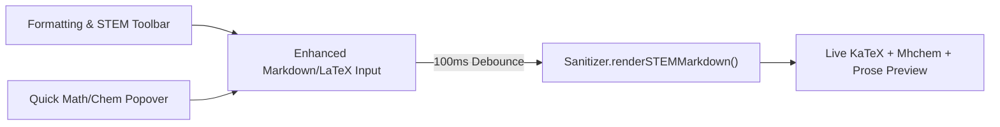
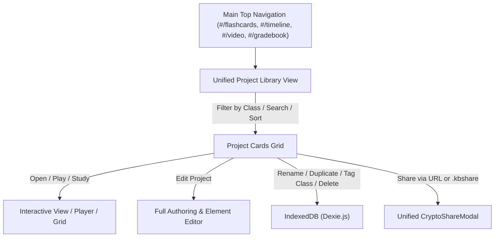
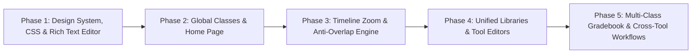

# KennisBoost Tools — Comprehensive Polishing & Revision Plan (v1.0)

> [!IMPORTANT]
> **Architectural Mandate:** KennisBoost Tools is a **100% client-side, local-first, zero-backend** educational technology suite built with Vanilla ES Modules, IndexedDB (`Dexie.js`), Origin Private File System (OPFS), Web Crypto API (`AES-256-GCM` / `PBKDF2`), Shoelace Web Components, KaTeX + Mhchem, and a static CSS utility stylesheet (`css/tailwind.output.css` + `css/app.css`). Every enhancement in this plan preserves zero-cloud privacy (FERPA/GDPR compliance by design), deterministic data validation (`Zod`), and strict XSS sanitization (`DOMPurify`).

---

## Table of Contents

1. [Executive Summary & Codebase Audit Findings](#1-executive-summary--codebase-audit-findings)
2. [Area 1: Overall UI/UX Visual Refinement, Design System & Rich Text Editors](#2-area-1-overall-uiux-visual-refinement-design-system--rich-text-editors)
3. [Area 2: Platform Home Page, Onboarding & Command Hub](#3-area-2-platform-home-page-onboarding--command-hub)
4. [Area 3: Timeline Zoom Engine Overhaul & Multi-Scale Anti-Overlap System](#4-area-3-timeline-zoom-engine-overhaul--multi-scale-anti-overlap-system)
5. [Area 4: Unified Project Libraries & Full CRUD Across All Tools](#5-area-4-unified-project-libraries--full-crud-across-all-tools)
6. [Area 5: Global Class Organization, Tagging & Failsafe Multi-Class Gradebook](#6-area-5-global-class-organization-tagging--failsafe-multi-class-gradebook)
7. [Area 6: High-Impact EdTech Workflow Recommendations & Missing Features](#7-area-6-high-impact-edtech-workflow-recommendations--missing-features)
8. [Database Schema Migration & Validation Plan (`Dexie` v2 + `Zod`)](#8-database-schema-migration--validation-plan-dexie-v2--zod)
9. [Phased Implementation Roadmap & Verification Matrix](#9-phased-implementation-roadmap--verification-matrix)

---

## 1. Executive Summary & Codebase Audit Findings

A thorough line-by-line audit of the current codebase uncovered critical architectural bottlenecks, missing CSS utility classes, incomplete CRUD workflows, and mathematical edge cases that explain the current visual and functional gaps:

### 1.1 Critical Styling & Layout Bottlenecks (`css/tailwind.output.css` & `css/app.css`)
- **Uncompiled Tailwind Classes Used in Views:** `css/tailwind.output.css` is a manually curated 276-line static CSS subset (there is no Tailwind CLI build step in `package.json`). However, the JavaScript templates extensively use classes **that do not exist** in `css/tailwind.output.css` or `css/app.css`:
  - **Broken Grid Layouts:** `.lg:grid-cols-12`, `.lg:col-span-4`, `.lg:col-span-5`, `.lg:col-span-7`, `.lg:col-span-8` are used in `src/modules/flashcards/editor.js` and `src/modules/video/index.js`, but are completely missing from CSS! As a result, side-by-side split workspaces collapse into full-width vertical stacks.
  - **Broken 3D Flashcard Flip & Sizing:** `.perspective-1000`, `.transform-style-3d`, `.rotate-y-180`, `.aspect-video`, `.rounded-2xl`, `.shadow-xl`, `.shadow-2xl`, `.backdrop-blur-sm`, `.prose`, `.line-clamp-1`, `.line-clamp-2`, `.ring-2`, `.ring-blue-500`, and arbitrary value classes like `.top-[56px]`, `.left-[220px]`, `.max-h-[700px]`, `.min-h-[96px]`, `.text-[10px]` are missing from the stylesheet.
  - **Inconsistent Button & Control Styling:** Views mix raw `<button>` tags (with ad-hoc padding/hover states) and `<sl-button>` web components without a unified design token bridge.
  - **Browser-Native Blocking Dialogs:** Destructive actions and prompts (`confirm()`, `prompt()`) are used in Flashcards, Timeline, and Video Kiosk mode instead of accessible, styled `<sl-dialog>` modals.

### 1.2 Functional & Architectural Gaps Across Modules
- **No Home Page (`#/`):** Both `index.html` (brand link `href="#/flashcards"`) and `src/router.js` (`parseHash()` defaults to `#/flashcards`) bypass any landing or dashboard experience.
- **Timeline Axis Overlap & Missing Reference Bug:**
  - In `src/modules/timeline/canvas-renderer.js`, `_renderAxis()` draws tick marks at fixed `tickIntervalDays` (e.g., every 1 year when `ppd >= 0.05`, or every 100 years when `ppd < 0.005`). At `ppd = 0.05`, 1 year is `18.26px` wide, while label strings like `"1517"` or `"44 BCE"` are `35px–65px` wide, causing severe text collisions. When zoomed out further (`ppd = 0.0001`), 100 years is `3.65px` wide, turning `"16th Century BCE"` labels into an illegible black smear.
  - In `src/modules/timeline/index.js` (line 241), `#btn-zoom-reset` calls `parseHistoricalDateToDays(e.start_date)`, which is **not imported** in `src/modules/timeline/index.js` (throwing a `ReferenceError` when clicking "Fit View").
  - In `src/modules/timeline/index.js` (line 134), `#menu-share-timeline` is rendered in the HTML menu, but **has no event listener attached**, making timeline sharing non-functional.
- **Missing Project Libraries in Timeline & Video Assessment:**
  - While Flashcards has a library grid (`renderLibrary`), **Timeline** (`src/modules/timeline/index.js`) and **Video Assessment** (`src/modules/video/index.js`) immediately load `timelines[0]` or `videos[0]`. Users cannot create a second timeline or video project, view a library of projects, switch between projects, rename them, duplicate them, or delete them.
- **Incomplete Element Editing in Flashcards, Timeline, Video, and Gradebook:**
  - **Flashcards:** Data model inconsistency between `src/modules/flashcards/index.js` (sample deck seeds `card.front = 'string'`, `card.sketch_data = null`) and `src/modules/flashcards/editor.js` (expects `card.front = { text: '...', ttsLang: '...', sketchData: [...] }`). Furthermore, `StudyPlayer` (`src/modules/flashcards/study-player.js`) never renders `card.front.sketchData` or `card.back.sketchData` during study sessions!
  - **Video Assessment:** Users can only *add* and *delete* checkpoints (`src/modules/video/index.js`). Checkpoints cannot be edited once created; multiple-choice questions are hardcoded to 2 radio options in the creation modal (no way to add/remove options, set `multi_choice`, add option rationales, configure `open_response` keywords, or change point values); and the video title/source URL/provider cannot be edited in the UI.
  - **Gradebook:** Courses, students, assignments, categories, terms, and rubrics can only be seeded or added—there is **no UI to switch courses, create a second course, edit/delete a student, edit/delete an assignment, configure category weights/policies, or build/edit rubrics** (`RubricScorer` only opens a scoring drawer for `rubrics[0]` with `null` student context and discards the result without saving to a grade cell!).
  - **Gradebook Virtual Grid Positioning Bug:** `src/modules/gradebook/virtual-grid.js` uses uncompiled Tailwind arbitrary classes `top-[56px] left-[220px]` on `#grid-virtual-cells`, causing virtual cells to misalign with the header and student column, and `VirtualGradebookGrid` never attaches `course_id` when creating a new grade record (`commit()`), causing `storage.table('gradebook_grades').filter(g => g.course_id === activeCourse.id)` to lose newly entered grades on page reload!

---

## 2. Area 1: Overall UI/UX Visual Refinement, Design System & Rich Text Editors

### 2.1 Complete CSS Design System & Utility Engine (`css/app.css` & `css/tailwind.output.css`)

#### 2.1.1 Design Tokens & Visual Hierarchy
Update `css/app.css` to establish a cohesive, modern EdTech design system with CSS custom properties synchronized with Shoelace tokens:
- **Color Palette & Surface Hierarchy:**
  - `--kb-bg-app: #f8fafc` (Slate 50 canvas background)
  - `--kb-surface: #ffffff` (Primary card/panel surface)
  - `--kb-surface-subtle: #f1f5f9` (Secondary toolbar/header surface)
  - `--kb-surface-elevated: #ffffff` with refined layered shadows (`--kb-shadow-sm`, `--kb-shadow-md`, `--kb-shadow-lg`, `--kb-shadow-float`)
  - `--kb-primary: #2563eb` (Blue 600), `--kb-primary-hover: #1d4ed8` (Blue 700), `--kb-primary-soft: #eff6ff` (Blue 50)
  - **Class Tag Color Palette:** 8 accessible, high-contrast semantic presets (Blue, Emerald, Violet, Amber, Rose, Cyan, Indigo, Teal) with paired background, border, and text tokens for class badges.
- **Typography Scale:**
  - System UI sans-serif stack for interface clarity; `ui-monospace` (`JetBrains Mono` / `SFMono-Regular` fallback) for timestamps, scores, IDs, and cryptographic digests.
  - Consistent page header hierarchy: `.kb-page-title` (`1.5rem`, `700`, `-0.025em` tracking), `.kb-section-title` (`1.125rem`, `600`), `.kb-helper-text` (`0.8125rem`, `#64748b`).
- **Spacing & Layout Rhythm:**
  - Standardize container padding (`24px` desktop, `16px` mobile), card internal padding (`20px–24px`), section gaps (`24px`), and control group gaps (`8px–12px`).

#### 2.1.2 Missing Utility Classes Restoration
Add all missing layout, grid, 3D transform, and typography classes to `css/tailwind.output.css` and `css/app.css`:
- **12-Column Responsive Grid System:** `.grid-cols-12`, `.lg:grid-cols-12`, `.lg:col-span-3`, `.lg:col-span-4`, `.lg:col-span-5`, `.lg:col-span-6`, `.lg:col-span-7`, `.lg:col-span-8`, `.lg:col-span-9`.
- **3D Flashcard Flip Utilities:**
  ```css
  .perspective-1000 { perspective: 1000px; }
  .transform-style-3d { transform-style: preserve-3d; }
  .backface-hidden { backface-visibility: hidden; }
  .rotate-y-180 { transform: rotateY(180deg); }
  ```
- **Aspect Ratio, Line Clamping & Prose Styling:** `.aspect-video` (`aspect-ratio: 16 / 9`), `.line-clamp-1`, `.line-clamp-2`, `.line-clamp-3`, `.rounded-2xl`, `.shadow-xl`, `.shadow-2xl`, `.backdrop-blur-sm`, and `.kb-prose` (styled headings, lists, blockquotes, code blocks, tables, and KaTeX blocks inside rendered Markdown).

#### 2.1.3 Unified Button & Interactive Component Standards
Create a standardized component style guide enforced across every module:
- **Primary Actions (`<sl-button variant="primary" size="small|medium">`):** Used for main view CTAs ("New Deck", "New Timeline", "New Video Assessment", "Save Changes", "Add Assignment").
- **Secondary / Neutral Actions (`<sl-button variant="default" size="small|medium">`):** Used for secondary toolbar actions ("Import CSV", "Export", "Filter", "Fit View").
- **Subtle / Icon Actions (`.kb-icon-btn`):** A standardized `32px × 32px` (or `36px × 36px` on touch devices) rounded button class (`border-radius: 8px`, subtle slate text, hover background `#f1f5f9`, active scale micro-interaction, visible focus ring) replacing all raw unstyled `<button>` elements.
- **Modal Replacement for Native Prompts:** Replace all `window.confirm()` and `window.prompt()` calls with a reusable `ConfirmDialog.show({ title, message, confirmText, variant })` and `PromptDialog.show({ title, label, defaultValue })` utility in `src/utils/dialogs.js` built on `<sl-dialog>`.

---

### 2.2 Reusable Rich Text & STEM Editor Component (`src/components/rich-text-editor.js`)

Currently, users must manually type raw Markdown and LaTeX syntax (`$$...$$`, `\ce{...}`) into plain `<sl-textarea>` fields across Flashcards, Timeline, Video Checkpoints, and Gradebook Feedback.

We will build a lightweight, zero-dependency, reusable **`RichTextEditor`** component (`src/components/rich-text-editor.js`) that wraps an enhanced editor surface with a formatting toolbar and live split/tabbed preview:



#### 2.2.1 Rich Text Toolbar Features
1. **Typography & Inline Formatting:**
   - **Bold** (`**text**`, `Ctrl/Cmd+B`), *Italic* (`*text*`, `Ctrl/Cmd+I`), ~~Strikethrough~~ (`~~text~~`),<u>Underline</u> (`<u>text</u>`), `Inline Code` (`` `code` ``), Highlight (`==text==` or `<mark>`).
2. **Structure & Lists:**
   - Heading (`### `), Bullet List (`- `), Numbered List (`1. `), Blockquote (`> `), Horizontal Rule (`---`), Table template inserter.
3. **STEM (KaTeX & Mhchem) Quick-Insert Menu:**
   - **Inline Math** (`$...$`, `Ctrl/Cmd+M`), **Block Math** (`$$\n...\n$$`, `Ctrl/Cmd+Shift+M`), **Chemistry Formula** (`$\ce{...}$`, `Ctrl/Cmd+Shift+C`).
   - **Interactive Symbol & Formula Palette Popover:** Quick-click buttons for common educational notation so teachers and students don't need to memorize LaTeX:
     - *Math:* Fraction ($\frac{a}{b}$), Square Root ($\sqrt{x}$), Exponent ($x^n$), Subscript ($x_i$), Integral ($\int_{a}^{b}$), Summation ($\sum_{i=1}^{n}$), Greek letters ($\alpha, \beta, \Delta, \pi, \theta, \lambda$), Inequalities ($\le, \ge, \neq, \approx$).
     - *Chemistry (`mhchem`):* Reaction Arrow ($\ce{->}$), Reversible Equilibrium ($\ce{<=>}$), Precipitate ($\ce{v}$), Gas ($\ce{^}$), State symbols ($\ce{(s)}, \ce{(l)}, \ce{(g)}, \ce{(aq)}$), Ion charges ($\ce{Fe^{3+}}, \ce{SO4^{2-}}$).
4. **View Modes (Compact vs. Split):**
   - **Split View (Default for wide editors like Flashcards):** Left pane is the syntax-assisted editor with keyboard shortcuts; Right pane is the synchronized live preview.
   - **Tabbed View ("Write" | "Preview" tabs for compact modals):** Used inside Timeline Event modals, Video Checkpoint modals, and Gradebook Rubric Feedback drawers to save vertical space while giving full rich-text power.

#### 2.2.2 Where `RichTextEditor` Will Be Integrated
- **Flashcard Editor (`src/modules/flashcards/editor.js`):** Front card editor and Back card editor (plus optional Card Hint field).
- **Timeline Event Editor (`src/modules/timeline/index.js`):** Event Description field and Academic Citations field.
- **Video Assessment Checkpoint Editor (`src/modules/video/index.js`):** Question Prompt field, Option Rationale fields, and Note body field.
- **Gradebook (`src/modules/gradebook/rubric-builder.js` & `index.js`):** Qualitative Student Feedback editor and Course/Assignment description notes.

---

## 3. Area 2: Platform Home Page, Onboarding & Command Hub

Currently, opening the app redirects immediately to `#/flashcards`, leaving new users with no overview of what KennisBoost Tools is, how its local-first privacy works, or how the four tools connect.

### 3.1 Routing & Navigation Updates (`index.html`, `src/main.js`, `src/router.js`)
- Register `#/` (and `#/home`) as the default route in `src/main.js` and `src/router.js` (only falling back to `#/` when `window.location.hash` is empty).
- Add a **"Home"** link (`#/`) with `<sl-icon name="house-door"></sl-icon>` as the first item in the main navigation bar in `index.html`, and point the top-left **KennisBoost** brand logo to `#/`.

### 3.2 Home Page Architecture (`src/modules/home/index.js`)
Create a new modular controller `src/modules/home/index.js` that renders an engaging, informative, and actionable EdTech Home & Dashboard view containing 6 structured sections:

1. **Hero & Value Proposition Banner:**
   - **Headline:** *"KennisBoost Tools — Privacy-First Teaching & Learning Suite"*
   - **Subheadline:** Clear explanation of the platform's unique value: 100% browser-based, zero cloud accounts required, instant AES-256 encrypted URL lesson sharing, and offline-ready storage.
   - **Primary CTAs:**
     - *"Explore Interactive Demo Workspace"* (One-click button that seeds rich, cross-linked sample data across Classes, Flashcards, Timelines, Video Assessments, and Gradebook if not already loaded).
     - *"Create New Project..."* dropdown (Quick-create Deck, Timeline, Video Assessment, or Class).
     - *"Open Shared File (`.kbshare` / `.kbr`)"* button to immediately open a downloaded lesson or verify a student receipt from the home screen.

2. **Live Workspace At-a-Glance Metrics Bar:**
   - Queries IndexedDB in real-time to display 5 interactive stat cards:
     - **Active Classes** (count of classes + total students enrolled)
     - **Flashcard Decks** (total decks + count of cards currently **Due for FSRS Review today** with a 1-click *"Study Due Cards"* button)
     - **Interactive Timelines** (total timelines + total historical events)
     - **Video Assessments** (total interactive videos + checkpoints)
     - **Data & Sync Health** (Persistent storage status, MB used, last backup timestamp, and 1-click *"Backup Now"* action).

3. **"Continue Where You Left Off" (Recent Projects & Class Filter):**
   - Displays the 4 most recently modified projects across all tools (sorted by `updated_at`), showing the tool icon, project title, assigned **Class Tag badge**, last edited relative time, and direct **"Open"** / **"Edit"** / **"Share"** quick actions.

4. **Interactive Feature Showcase (The 4 Core Tools + Class Hub):**
   - Four rich cards explaining what is possible in each tool with capability badges and direct launch buttons:
     - **Flashcards & Study Engine:** FSRS v4 Spaced Repetition, KaTeX/Mhchem STEM formulas, Pressure-Sensitive Vector Sketch Pad, Multi-language TTS, and 60 FPS Tower Defense Study Game.
     - **Interactive Timeline Maker:** Astronomical BCE-to-Future date engine, multi-scale semantic zooming, automatic lane collision packing, category filtering, and standalone Vector SVG export.
     - **Video Assessment Platform:** Multi-provider support (HTML5, YouTube, Vimeo), anti-scrub playhead gatekeeper, interactive multiple-choice & open-response checkpoints, and SHA-256 cryptographically signed student `.kbr` receipts.
     - **Multi-Class Browser Gradebook:** 60 FPS 2D virtualized spreadsheet, Traditional Weighted & Standards-Based Grading (Marzano Power Law / Decaying Average), interactive Rubric Click-Scorer, batch ZIP PDF report generator, and FERPA-isolated encrypted student links.

5. **How It Works: Teacher & Student Workflow Guide:**
   - Visual 3-step workflow tab switcher (**For Teachers** vs. **For Students**):
     - *Step 1: Organize & Author* (Create classes, build rich STEM lessons).
     - *Step 2: Share Zero-Server Links* (Generate AES-256 encrypted URLs or `.kbshare` files—no student accounts or servers needed).
     - *Step 3: Assess & Verify* (Students study or complete Kiosk assessments, returning tamper-proof `.kbr` cryptographic receipts directly into the Gradebook).

---

## 4. Area 3: Timeline Zoom Engine Overhaul & Multi-Scale Anti-Overlap System

### 4.1 Root Cause Diagnosis of the Timeline Overlap Issue
In `src/modules/timeline/canvas-renderer.js`:
1. **Fixed Resolution Tick Step Without Pixel-Density Clamping:**
   `_renderAxis()` selects one of 6 coarse buckets (`hour`, `day`, `month`, `year`, `decade`, `century`) and steps `d` by `tickIntervalDays`. Because `pixelsPerDay` varies continuously from `1e-4` (10,000 days per pixel) to `2400` (1 hour = 100 pixels), a single bucket spans a $10\times$ to $20\times$ zoom range. At the lower end of any bucket (or anywhere below `ppd = 0.01`), adjacent tick labels are drawn every `3px–25px`, while the text width is `45px–110px`, causing guaranteed horizontal overlap of axis dates.
2. **Event Card Horizontal Explosion When Zoomed Out:**
   In `assignTimelineLanes()`, every event card is forced to a minimum pixel width of `Math.max(130, ev.title.length * 7.5 + 32)`. When zoomed out so that 2,000 years fit in a `900px` canvas, 20 events in the same era all span `150px–250px` each, forcing `assignTimelineLanes()` to stack them into 15–20 vertical lanes that overflow off the bottom of the fixed `500px` canvas (with no vertical scrolling or clustering!).
3. **Unclamped Zoom & Pan Bounds:**
   Users can zoom out until the entire history of the universe is `1px` wide, or pan millions of years into empty space, losing their events completely.

### 4.2 Comprehensive Timeline Engineering Solution (`src/modules/timeline/canvas-renderer.js`)

#### 4.2.1 Dynamic "Nice-Number" Multi-Scale Axis Tick Generator
Replace the rigid 6-bucket `tickIntervalDays` logic in `_renderAxis()` with a **continuous pixel-aware nice-interval algorithm** that guarantees a minimum spacing of **`MIN_TICK_SPACING_PX = 110px`** between major tick labels at *any* zoom level:

| Zoom Scale (`pixelsPerDay`) | Target Step Unit | Allowed "Nice" Multipliers | Example Major Axis Label | Minor Sub-Ticks |
| :--- | :--- | :--- | :--- | :--- |
| `> 40` | Hours | 1h, 2h, 3h, 6h, 12h | `14:00` (with sticky date header) | 15m / 1h |
| `1.5 – 40` | Days | 1d, 2d, 5d, 7d, 14d | `1969-07-20` / `Jul 20, 1969` | 1d |
| `0.15 – 1.5` | Months | 1m, 2m, 3m, 6m | `Oct 1517` | 1m |
| `1e-5 – 0.15` | Astronomical Years | `1, 2, 5, 10, 20, 25, 50, 100, 200, 250, 500, 1000, 2000, 5000, 10000` yrs | `44 BCE`, `1500 CE`, `2000 CE` | 5 subdivisions per major interval |

- **Algorithm Details:**
  1. Compute `minDaysBetweenLabels = MIN_TICK_SPACING_PX / this.pixelsPerDay`.
  2. Select the smallest step from the nice interval ladder where `stepDays >= minDaysBetweenLabels`.
  3. **Calendar-Aligned Snapping:** Snap year ticks to clean multiples of the step (e.g., for `step = 250 years`, ticks land cleanly on `500 BCE`, `250 BCE`, `1 CE`, `250 CE`, `500 CE`, `1500 CE`, `1750 CE`, `2000 CE` rather than arbitrary floating-point epoch offsets).
  4. **Collision Guard Pass (`ctx.measureText`):** Before drawing any axis label, measure its pixel width `w = ctx.measureText(label).width`. Track `lastLabelRightPx`. If `x - w / 2 < lastLabelRightPx + 12`, skip the text label and render a minor tick mark instead. **Dates can never overlap under any circumstance.**
  5. **Two-Tier Axis Header (Context + Detail):** Render a subtle upper context band on the axis showing the current Era / Century / Year range visible in the viewport, with major tick labels and minor subdivision ticks below it.

#### 4.2.2 Semantic Zoom Modes & Automatic Event Clustering (Macro vs. Meso vs. Micro)
Introduce 3 adaptive visual levels of detail (LOD) for events based on `pixelsPerDay` and screen density:
1. **Detailed Card Mode (Zoomed In / Standard):** Full rounded cards with date badge prefix (`1517-10-31`), category color pill, and title text, arranged via greedy lane allocation.
2. **Compact Pill Mode (Medium Zoom):** Compact pill (`max-width: 140px` with ellipsis truncation) and hover tooltip card showing full title, exact date, and category.
3. **Smart Cluster Node Mode (Zoomed Out Far):**
   - When multiple events fall within `CLUSTER_THRESHOLD_PX = 28px` on the horizontal axis and would require more than `MAX_COMFORTABLE_LANES = 5` vertical lanes, automatically group nearby events into an interactive **Cluster Badge** (`+4 Events • 44 BCE – 180 CE`) on the timeline.
   - **Hovering a Cluster Badge** displays a floating glassmorphism preview card listing the events inside.
   - **Clicking a Cluster Badge** smoothly animates (`requestAnimationFrame` cubic-ease interpolation over `350ms`) `centerDay` and `pixelsPerDay` to zoom directly into that cluster's temporal span!

#### 4.2.3 Vertical Panning, Minimap Overview Bar & Smooth Zoom Controls
- **Dynamic Vertical Scrolling / Panning:** Support vertical panning and automatic canvas height expansion when a dense era has many lanes, plus a vertical scrollbar indicator on the canvas.
- **Interactive Bottom Minimap / Navigator Bar:** Render a `36px` overview bar at the bottom of the timeline canvas showing the full span of all timeline events as miniature dots/bars and a draggable shaded viewport rectangle showing where the user is currently zoomed.
- **Fix `#btn-zoom-reset` Bug & Add Zoom Slider:** Import `parseHistoricalDateToDays` properly in `src/modules/timeline/index.js`, add a visual zoom level indicator badge (e.g., `Scale: Centuries` / `Scale: Decades` / `Scale: Years` / `Scale: Days`), and add a smooth zoom slider alongside the `+` / `-` / `Fit View` buttons.

---

## 5. Area 4: Unified Project Libraries & Full CRUD Across All Tools

To make every tool feel like a cohesive, first-class application, **Flashcards**, **Timeline**, **Video Assessment**, and **Gradebook** will share a unified **Library & Workspace Architecture**.



### 5.1 Unified Project Library & Share Modal Components
1. **`src/components/project-library.js` (`ProjectLibraryView`):**
   - A standardized, reusable library header and card grid shell used by Flashcards, Timelines, Video Assessments, and Gradebook Courses:
     - **Top Filter & Action Bar:** Search input (filters by title/description/tags), **Class Filter Dropdown** (`All Classes`, `Unassigned`, or specific Class), **Sort Dropdown** (`Last Updated`, `Alphabetical A–Z`, `Class`), **Import Button** (CSV / `.kbshare`), and **Primary "+ New [Project]" CTA**.
     - **Standardized Project Card:**
       - Color-coded top accent strip matching the assigned **Class color** (or tool brand color).
       - **Title** with 1-click inline rename (or Rename via action menu).
       - **Class Tag Badge(s)** (clickable to filter or reassign class).
       - **Metadata Summary:** Item count (e.g., `24 Cards • 8 Due Today`, `18 Events • 44 BCE – 1969`, `5 Checkpoints • YouTube`, `28 Students • 12 Assignments`) and relative `updated_at` timestamp (`Updated 2h ago`).
       - **Primary Card Footer Buttons:** Open/Launch button + Edit button + Share button.
       - **`<sl-dropdown>` Context Menu:** *Open*, *Edit*, *Rename Project*, *Assign to Class...*, *Duplicate Project*, *Export (CSV / Markdown / JSON / SVG)*, *Share via Encrypted URL / `.kbshare`*, and *Delete Project* (with accessible `<sl-dialog>` confirmation).
2. **`src/components/share-dialog.js` (`ShareModal`):**
   - Extract the duplicated `openShareDialog()` functions from `flashcards/index.js` and `video/index.js` into a single, polished `ShareModal.open(dataObject, moduleType)` component.
   - Features: Optional AES-256 passphrase protection, URL length meter (`1,420 / 2,048 chars — Safe for all browsers & LMS`), 1-click **Copy URL**, **Download `.kbshare` File**, and **Import `.kbshare` File** support across all 4 tools.

---

### 5.2 Tool-by-Tool Interface & Editing Refinements

#### 5.2.1 Flashcards Tool (`src/modules/flashcards/`)
1. **Data Model Normalization (`index.js`, `editor.js`, `study-player.js`, `tower-defense.js`):**
   - Normalize the sample STEM deck in `src/modules/flashcards/index.js` (and add a migration helper) so `card.front` and `card.back` always follow `CardSideSchema` (`{ text: string, ttsLang: string, sketchData?: Stroke[], mediaUrl?: string }`).
2. **Flashcard Editor Enhancements (`editor.js`):**
   - Replace plain textareas with the new `RichTextEditor` (supporting formatting toolbar, KaTeX/Mhchem quick-insert, and live preview).
   - **Deck Metadata Bar:** Edit Deck Title, Deck Description, and **Class Assignment Tag** directly in the editor header.
   - **Card Reordering & Search:** Add Move Up (`↑`) / Move Down (`↓`) buttons, card search filter in the left sidebar, and keyboard navigation (`Alt+Up`/`Alt+Down` to switch cards, `Ctrl/Cmd+Enter` to add a new card).
   - **Inline Sketch Thumbnail Preview:** Show a miniature preview badge on the Front/Back editor when a vector drawing is attached, with 1-click "Edit Sketch" or "Remove Sketch".
   - **Auto-Save Indicator:** Automatically persist changes to IndexedDB on a `600ms` debounce (in addition to the explicit "Save & Return" button) so teachers never lose card edits.
3. **Study Player Enhancements (`study-player.js`):**
   - **True 3D Card Flip & Sketch Rendering:** Fix the CSS 3D flip container and render attached vector `sketchData` on a read-only `<canvas>` (or SVG data URL) on both the front and back of the flashcard during study sessions!
   - **Study Mode Selector:** Allow studying **Due Cards Only (FSRS v4)**, **Cram All Cards (Shuffled)**, or **Starred/Difficult Cards Only**.
   - **Live FSRS Interval Preview on Buttons:** Calculate and display the exact real-time FSRS next interval for `Again`, `Hard`, `Good`, and `Easy` on the 4 grading buttons for the current card instead of hardcoded `(1d) / (3d) / (7d)` labels.
   - **Quick "Edit Card" Button in Study Mode:** Allow fixing a typo on a card mid-study session via a modal without losing session progress.

#### 5.2.2 Interactive Timeline Tool (`src/modules/timeline/`)
1. **Timeline Library (`#/timeline`) & Workspace Sub-Routes (`#/timeline/view?id=...`):**
   - Default `#/timeline` displays the **Timeline Library** (`ProjectLibraryView`) showing all saved timelines, sample history/STEM timelines, and class filters.
   - Clicking a timeline opens `#/timeline/view?id=<uuid>` with a "← Back to Library" button in the top toolbar.
2. **Full Timeline & Event Editing (`src/modules/timeline/index.js`):**
   - **Inline Timeline Title, Description & Class Tag Editing** in the timeline workspace header.
   - **Dual View Switcher (Interactive Canvas View vs. Chronological Table/List View):**
     - Add a segmented toggle (`Canvas View` | `Split View` | `Table View`). In `Split` or `Table` view, users can see all events in a sortable chronological table with direct **Edit**, **Duplicate**, **Center on Canvas**, and **Delete** buttons—making bulk editing of 50+ events effortless and 100% accessible.
   - **Enhanced Event Editor Modal:**
     - Integrate `RichTextEditor` for Event Description.
     - Add **Era / BCE Helper Toggle:** Easy toggle between `CE (AD)` and `BCE (BC)` alongside year/month/day inputs so teachers don't have to remember ISO signed-year formatting (`-0044-03-15` vs `44 BCE`).
     - Connect `#menu-share-timeline` to `ShareModal.open(activeTimeline, 'timeline')`.

#### 5.2.3 Video Assessment Tool (`src/modules/video/`)
1. **Video Assessment Library (`#/video`) & Sub-Routes (`#/video/edit?id=...`, `#/video/kiosk?id=...`):**
   - Default `#/video` displays the **Video Assessment Library** (`ProjectLibraryView`), allowing teachers to create multiple video assessments, filter by class, duplicate assessments, share student Kiosk links directly, or open the **Receipt Verifier & Grade Importer**.
2. **Full Video & Checkpoint Editing (`src/modules/video/index.js`):**
   - **Video Project Settings Panel:** Allow editing the **Assessment Title**, **Class Assignment Tag**, **Video Provider** (`HTML5 MP4/WebM URL`, `YouTube URL/ID`, `Vimeo URL/ID`), and **Video Source URL** with a live "Reload Video Preview" button.
   - **Full Checkpoint CRUD (Create, Edit, Duplicate, Reorder, Delete):**
     - Clicking any checkpoint in the right-hand "Checkpoints Timeline" list seeks the editor video player to `cp.timestamp_sec` and opens the **Edit Checkpoint Modal**.
     - **Visual Checkpoint Markers on the Video Scrubber Bar:** Render interactive colored dots along the video progress bar in both Teacher Editor mode and Student Kiosk mode showing exactly where checkpoints occur.
   - **Upgraded Checkpoint Authoring Modal:**
     - **Editable Timestamp (`mm:ss.s` or seconds):** Fine-tune the exact trigger timestamp without deleting and recreating the checkpoint.
     - **Editable Points Value:** Configure `points` (`0` to `100`).
     - **All 4 Question Types Fully Supported:**
       1. `single_choice` (Multiple Choice — Single Answer)
       2. `multi_choice` (Multiple Select — Checkboxes, previously supported in `interceptor.js` & `validator.js` but missing from the authoring UI!)
       3. `open_response` (Short/Open Answer with configurable **Auto-Grade Keywords** chip input and optional model answer)
       4. `note` (Pause & Read Instructional Note / Rich STEM callout)
     - **Dynamic Options Builder for Choice Questions:** Add/remove up to 8 options (minimum 2), mark correct answer(s), and add per-option **Feedback / Rationale** text so students see why an answer was right or wrong.
     - **Rich Text & STEM Prompt:** Use `RichTextEditor` for `prompt_markdown` so video questions can include chemical equations, math formulas, and formatted code.
3. **Kiosk Mode UX & Accessibility Polish:**
   - Replace the blocking browser `prompt('Enter your Student Name or ID...')` with a clean, welcoming **Student Kiosk Start Card** showing the assessment title, class name, checkpoint count, and input fields for **Student Full Name** and **Student ID** (which pre-fills if launched from a class roster!).

---

## 6. Area 5: Global Class Organization, Tagging & Failsafe Multi-Class Gradebook

### 6.1 Global Class Organization Architecture (`classes` Store & Cross-Tool Tagging)

To unify the platform for teachers managing multiple periods, subjects, or sections (e.g., *"Period 1 — AP Chemistry"*, *"Period 3 — Honors Biology"*, *"World History 101"*):

#### 6.1.1 Unified Class Entity & Synchronization with Gradebook Courses
- In KennisBoost Tools, a **Class** (`gradebook_courses` / global `classes` entity) serves as both:
  1. The organizational tag for **Flashcard Decks**, **Timelines**, and **Video Assessments** (`class_id` or `class_ids: string[]`).
  2. The course container in the **Gradebook** (holding the Student Roster, Grading Scale, Categories, Terms, Assignments, and Rubrics).
- Creating a Class anywhere in the platform makes it immediately available for tagging Flashcards, Timelines, and Video Assessments **and** selectable as an active Class in the Gradebook!

#### 6.1.2 Global Class Switcher & Class Manager Modal (`src/components/class-manager.js`)
- **Header Context Pill / Class Switcher (`index.html`):**
  - Add a global **"Class Filter / Manage Classes"** selector in the top navigation bar (next to the tool tabs).
  - Teachers can set an active class filter globally (e.g., *"AP Chemistry — Period 1"*) so switching between Flashcards, Timeline, Video Assessment, and Gradebook automatically focuses on that class's materials and roster, or select *"All Classes"* to view everything.
- **Class Manager Modal:**
  - Create, edit, archive, or delete classes with:
    - **Class Name** (e.g., `AP Chemistry`)
    - **Section / Period** (e.g., `Period 2 • Room 304`)
    - **Academic Year / Term** (e.g., `2026–2027`)
    - **Color Theme Badge** (8 accessible color presets)
    - **Linked Resources Summary:** Shows counts of tagged Flashcard Decks, Timelines, Video Assessments, and Enrolled Students, with 1-click navigation to each.

---

### 6.2 Multi-Class Gradebook & Failsafe UI/UX Overhaul (`src/modules/gradebook/`)

#### 6.2.1 Intuitive Multi-Class Navigation & Course Management
- **Class Switcher Bar & Course Library Drawer:**
  - At the top of `#/gradebook`, provide an instant **Class Selector Dropdown / Tab Strip** showing all classes with their color badge, student count, and class average, plus a **"+ New Class"** button and **"Class Settings"** button.
  - **Clone Class Structure Action:** Allow teachers to duplicate a class's categories, terms, rubrics, and assignment templates into a new section/period (e.g., cloning *Period 1 AP Chemistry* into *Period 3 AP Chemistry* without copying student grades).
- **Course Settings & Policy Editor Modal:**
  - Full UI to add, edit, reorder, and delete **Grading Categories** (Name, Weight %, Drop Lowest $N$, Late Penalty Mode: None / Fixed % / Daily % with Cap, Missing Floor %) with a live validation indicator ensuring category weights sum to `100%`.
  - Full UI to manage **Academic Terms / Semesters** and filter the gradebook grid by Term (`All Terms`, `Fall Semester`, `Spring Semester`).

#### 6.2.2 Complete CRUD for Students, Assignments & Rubrics
- **Student Roster Management:**
  - Clicking a student's name or row menu in the left pinned column opens the **Student Detail & Edit Drawer**:
    - Edit Full Name, Student ID, Email, and Teacher Private Notes.
    - View individual student performance summary (Category breakdown, Missing/Late count, Grade trend sparkline).
    - Quick actions: *Generate Student PDF Report*, *Copy Encrypted Student Link*, or *Remove Student from Class* (with confirmation).
- **Assignment Header Management:**
  - Clicking an assignment column header (or its `⋮` icon) opens the **Assignment Actions Popover / Edit Modal**:
    - Edit Title, Category, Term, Due Date, Max Points, and Attached Rubric.
    - **Bulk Column Failsafe Actions:**
      - *"Fill Empty Cells with Max Score"* (1-click for participation/completion assignments).
      - *"Mark Unsubmitted as Missing"*
      - *"Clear Column Scores"* (with confirmation + Undo).
      - *"Delete Assignment"* (with confirmation).
- **Full Rubric Builder & Connected Rubric Scorer (`src/modules/gradebook/rubric-builder.js`):**
  - Build a complete **Rubric Designer Modal** to create/edit custom rubrics (add/remove Tiers, add/remove Criteria, edit descriptors and point weights).
  - **Connect Rubrics to Gradebook Cells:** When an assignment has an attached `rubric_id`, clicking a cell (or its rubric icon badge) in the Gradebook Grid opens `RubricScorer.openScoringDrawer(rubric, gradeRecord, onCommit)` for **that specific student and assignment**, automatically saving the calculated score, `rubric_eval`, and qualitative `feedback` directly into `gradebook_grades`!

#### 6.2.3 Visual, UX & Failsafe Refinements to `VirtualGradebookGrid` (`src/modules/gradebook/virtual-grid.js`)
1. **Fix `course_id` Persistence Bug & Arbitrary CSS Positioning:**
   - Pass `courseId: activeCourse.id` into `VirtualGradebookGrid` and include `course_id: this.courseId` in `commit()` so entered grades persist across reloads.
   - Replace broken Tailwind arbitrary classes `top-[56px] left-[220px]` with explicit inline styles or standard CSS classes so the virtual cells align pixel-perfectly with the sticky header and sticky student column.
2. **Spreadsheet-Grade Keyboard Navigation & Quick Status Entry:**
   - **Arrow Keys / Tab / Enter Navigation:** `Enter` or `ArrowDown` commits and moves down; `Shift+Enter` or `ArrowUp` moves up; `Tab` / `ArrowRight` moves right; `Shift+Tab` / `ArrowLeft` moves left; `Escape` cancels uncommitted edits.
   - **Single-Key Status Shortcuts Inside Active Cell:**
     - Typing `m` or `M` sets status to **`MISSING`** (`MISS` badge, applies missing floor policy).
     - Typing `e` or `E` sets status to **`EXEMPT`** (`EX` badge, excluded from calculation).
     - Typing `l` or `L` toggles **`LATE`** status (and prompts/allows setting `days_late`).
     - Typing a number (`85`) sets `raw_score = 85` and `status = 'submitted'`.
   - **Cell Context Popover (Right-click or Detail Icon):** Allows setting exact status (`Submitted`, `Late` + days late spinner, `Missing`, `Exempt`), typing a comment/feedback note, or launching the attached Rubric Scorer.
3. **Failsafe Data Entry Guardrails & Undo/Redo Stack:**
   - **Out-of-Bounds / Extra Credit Guard:**
     - Reject negative numbers (`< 0`).
     - If a teacher enters a score `> assignment.max_score` (e.g., `950` instead of `95` on a `100pt` exam), display a non-destructive warning badge/confirmation: *"950 exceeds max points (100). Keep as extra credit or fix typo?"* (if `> 150%` of `max_score`, prompt before committing; if `100%–150%`, highlight with a subtle `EC` Extra Credit emerald badge).
   - **20-Step Gradebook Undo/Redo Stack (`Ctrl/Cmd+Z` & `Ctrl/Cmd+Y`):**
     - Every cell edit or bulk column fill pushes a reversible command onto an in-memory Undo/Redo stack in the Gradebook toolbar so accidental overwrites can be undone in 1 click.
4. **Visual Readability & Analytics Polish:**
   - Zebra striping on alternating rows, full row + column crosshair highlight on hover/focus, color-coded letter grade pills (`A` Emerald, `B` Blue, `C` Amber, `D/F` Rose) in the pinned Student Total column, and a pinned **Class Average Footer Row** showing the mean/median score for every assignment column.

---

## 7. Area 6: High-Impact EdTech Workflow Recommendations & Missing Features

Based on how teachers and students actually use these tools in classrooms, the following high-leverage workflow integrations will transform KennisBoost Tools from 4 separate utilities into an interconnected EdTech ecosystem:

### 7.1 Direct `.kbr` Video Receipt & Quiz Import into Gradebook
- **Current Gap:** Students complete a Video Assessment in Kiosk mode and download a cryptographically signed `.kbr` receipt, and teachers can verify a single `.kbr` file in the Video tool—but teachers still have to manually type those scores into the Gradebook.
- **New Workflow:** Add an **"Import `.kbr` Receipts to Assignment"** action in the Gradebook (supporting multi-file selection of `.kbr` files). The Gradebook verifies each cryptographic SHA-256 signature via `KioskReportEngine.verifyReceipt()`, matches `studentName` / `studentId` to the class roster, and populates all students' scores and response logs in one step!

### 7.2 Cross-Tool Content Conversion ("Timeline ↔ Flashcards" & "Flashcards → Printable Study Sheet")
- **Generate Flashcards from Timeline (`src/modules/timeline/index.js`):**
  - Add a **"Create Flashcard Deck from Timeline"** action in the Timeline Export menu. Automatically converts each timeline event into a flashcard (`Front`: Event Title & Category, `Back`: Date Span, Description, and Citations) tagged to the same Class!
- **Printable PDF Study Guide & Worksheet Generator (`src/modules/flashcards/index.js`):**
  - Using the already-installed `jspdf` and `jspdf-autotable` libraries, add **"Export Printable Study Guide / Folding Flashcards (PDF)"** so teachers can print physical study handouts or offline worksheets for students without devices.

### 7.3 Dark Mode & High-Contrast Accessibility Theme Toggle
- **Current Gap:** `index.html` already loads both Shoelace themes (`light.css` and `dark.css`) and sets `<html class="sl-theme-light">`, but there is no theme toggle in the UI.
- **New Workflow:** Add a **Theme Toggle (`Light` / `Dark` / `High-Contrast Projector Mode`)** in the top header bar, persisted in `app_metadata`. Classroom projectors often wash out subtle slate borders; **Projector / High-Contrast Mode** increases border contrast and font weight for front-of-class presentations.

### 7.4 Universal Command Palette (`Ctrl/Cmd + K`) & Keyboard Shortcuts Modal (`?`)
- Build a lightweight **Command Palette (`Ctrl/Cmd + K`)** (`src/components/command-palette.js`) that lets teachers and students jump directly to any Class, Flashcard Deck, Timeline, Video Assessment, or action ("New Deck", "Export Backup", "Switch Class") from anywhere in the app.
- Add a **`?` Keyboard Shortcuts Cheat Sheet Modal** showing all shortcuts for Flashcard FSRS study (`Space`, `1–4`), Timeline navigation (`←`, `→`, `Enter`, `Wheel`), and Gradebook spreadsheet entry (`Enter`, `Tab`, `Arrows`, `M`, `E`, `L`, `Ctrl+Z`).

---

## 8. Database Schema Migration & Validation Plan (`Dexie` v2 + `Zod`)

### 8.1 IndexedDB Version 2 Upgrade (`src/core/storage.js`)
Upgrade `Dexie('KennisBoostDB')` from `version(1)` to `version(2)` while preserving 100% of existing user data:

```javascript
this.db.version(2).stores({
  flashcards: 'id, title, class_id, updated_at',
  timelines: 'id, title, class_id, updated_at',
  video_assessments: 'id, title, class_id, updated_at',
  gradebook_courses: 'id, name, section, academic_year, updated_at',
  gradebook_students: 'id, course_id, student_id, full_name',
  gradebook_assignments: 'id, course_id, term_id, category_id, due_date',
  gradebook_grades: '[student_id+assignment_id], course_id, student_id, assignment_id, status',
  gradebook_rubrics: 'id, course_id, title',
  app_metadata: 'key',
  binary_blobs: 'id, mime_type, size_bytes'
}).upgrade(async tx => {
  // Normalize legacy flashcard items where front/back were plain strings
  await tx.table('flashcards').toCollection().modify(deck => {
    deck.class_id = deck.class_id || null;
    if (Array.isArray(deck.cards)) {
      deck.cards = deck.cards.map(c => ({
        ...c,
        front: typeof c.front === 'string'
          ? { text: c.front, ttsLang: c.tts_lang || 'en-US', sketchData: c.sketch_data || undefined }
          : c.front,
        back: typeof c.back === 'string'
          ? { text: c.back, ttsLang: c.tts_lang || 'en-US', sketchData: undefined }
          : c.back
      }));
    }
  });
  await tx.table('timelines').toCollection().modify(t => {
    t.class_id = t.class_id || null;
    t.updated_at = t.updated_at || new Date().toISOString();
  });
  await tx.table('video_assessments').toCollection().modify(v => {
    v.class_id = v.class_id || null;
    v.updated_at = v.updated_at || new Date().toISOString();
  });
  await tx.table('gradebook_courses').toCollection().modify(c => {
    c.color = c.color || '#2563eb';
    c.section = c.section || 'Section 1';
    c.updated_at = c.updated_at || new Date().toISOString();
  });
});
```

### 8.2 Zod Schema Additions (`src/core/validator.js`)
- Add optional `class_id: z.string().uuid().nullable().optional()`, `description: z.string().optional()`, and `tags: z.array(z.string()).default([])` to `FlashcardSetSchema`, `TimelineDatasetSchema`, and `VideoAssessmentSchema`.
- Add `section: z.string().optional()`, `color: z.string().default('#2563eb')`, and `updated_at: z.string().optional()` to `GradebookCourseSchema`.

---

## 9. Phased Implementation Roadmap & Verification Matrix



### Phase 1: Foundation — Design System, CSS Restoration & Reusable Components
- **Files to Modify / Create:**
  - `css/tailwind.output.css` & `css/app.css`: Add all missing 12-column grid utilities, 3D card flip rules, aspect-ratio, prose typography, class color tokens, and dark/high-contrast theme variables.
  - `src/utils/dialogs.js` *(New)*: Accessible `<sl-dialog>` replacements for `confirm()` and `prompt()`.
  - `src/components/rich-text-editor.js` *(New)*: Reusable Markdown + KaTeX + Mhchem Rich Text Editor with formatting toolbar, STEM symbol palette, and split/tabbed live preview.
  - `src/components/share-dialog.js` *(New)*: Unified encrypted URL & `.kbshare` export/import modal.

### Phase 2: Global Class System, Database v2 & Platform Home Page
- **Files to Modify / Create:**
  - `src/core/storage.js` & `src/core/validator.js`: Dexie v2 schema upgrade (`class_id` indexing, legacy card normalization) and Zod schema updates.
  - `src/components/class-manager.js` *(New)*: Global Class Switcher in navbar + Class CRUD & Tagging Manager modal.
  - `src/modules/home/index.js` *(New)*: Full Home Page with Hero, Live Workspace Metrics, Recent Projects, Tool Showcase, and Teacher/Student Workflow Guide.
  - `index.html`, `src/main.js`, `src/router.js`: Register `#/` Home route, add Home nav item, and wire global Class Switcher & Theme Toggle.

### Phase 3: Timeline Multi-Scale Zoom Engine & Anti-Overlap Overhaul
- **Files to Modify:**
  - `src/modules/timeline/canvas-renderer.js`: Implement pixel-aware nice-number tick interval solver, `ctx.measureText` collision guard, calendar-aligned BCE/CE tick snapping, smart event clustering at macro zoom, vertical lane scrolling, and bottom minimap overview bar.
  - `src/modules/timeline/index.js` & `src/modules/timeline/svg-exporter.js`: Fix missing `parseHistoricalDateToDays` import on "Fit View", wire `#menu-share-timeline`, add Zoom Scale indicator + slider, and add Canvas/Table split view.

### Phase 4: Unified Project Libraries & Full Authoring CRUD (Flashcards, Timeline, Video)
- **Files to Modify / Create:**
  - `src/components/project-library.js` *(New)*: Reusable library grid with search, class filter, inline rename, duplicate, class assignment, share, and delete.
  - `src/modules/flashcards/index.js`, `editor.js`, `study-player.js`: Integrate `ProjectLibraryView`, `RichTextEditor`, sketch rendering in `StudyPlayer`, real-time FSRS button interval previews, and PDF Study Guide export.
  - `src/modules/timeline/index.js`: Add Timeline Library view (`#/timeline`), event duplication, BCE/CE date helper, `RichTextEditor` description, and "Generate Flashcard Deck from Timeline".
  - `src/modules/video/index.js`, `interceptor.js`: Add Video Assessment Library view (`#/video`), video source/provider settings editor, full checkpoint editing/reordering, visual checkpoint markers on the scrubber bar, dynamic options/rationales/keywords builder, and non-blocking Student Kiosk start screen.

### Phase 5: Multi-Class Gradebook Overhaul & EdTech Ecosystem Polish
- **Files to Modify / Create:**
  - `src/modules/gradebook/index.js`: Multi-class switcher, "+ New Class" & "Clone Class", Course Settings (Categories/Weights/Policies/Terms) modal, Student Detail/Edit drawer, Assignment Edit & Bulk Fill actions, and batch `.kbr` receipt importer.
  - `src/modules/gradebook/virtual-grid.js`: Fix `course_id` save bug, fix cell positioning alignment, add full arrow/tab/enter keyboard navigation, single-key status shortcuts (`M`, `E`, `L`), out-of-bounds score guardrails, Undo/Redo stack (`Ctrl+Z`/`Ctrl+Y`), and pinned Class Average footer row.
  - `src/modules/gradebook/rubric-builder.js`: Add full Rubric Designer UI and connect Rubric Scorer directly to individual student-assignment cells.
  - `src/components/command-palette.js` *(New)*: `Ctrl/Cmd + K` quick navigation palette and `?` keyboard shortcut reference modal.

### Verification & Testing Matrix (`vitest`)
1. **Unit & Schema Tests:** Verify Dexie v2 migration, `RichTextEditor` sanitization through `Sanitizer.renderSTEMMarkdown`, and Zod validation for `class_id` tagging.
2. **Timeline Anti-Overlap Tests:** Programmatically test `TimelineCanvasRenderer` across `pixelsPerDay` from `1e-4` to `2400` and verify that no two rendered axis tick labels ever overlap (`labelA.right + 12 <= labelB.left`).
3. **Gradebook Failsafe Tests:** Verify `course_id` persistence on cell commit, Undo/Redo stack integrity, category weight normalization, and `.kbr` cryptographic receipt import into gradebook cells.
4. **Accessibility & Responsive Audit:** Verify WCAG 2.1 AA contrast ratios in Light, Dark, and Projector themes, full keyboard operability across all modals/drawers, and responsive 12-column layouts on mobile, tablet, and desktop viewports.
